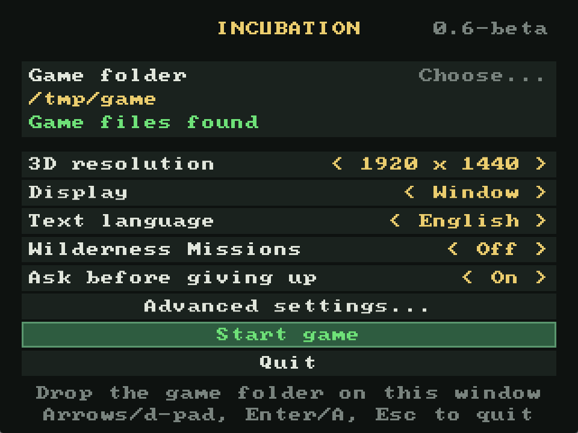

# Incubation, recompiled

A native Windows and Linux version of Incubation, made by translating the game's original Windows program statically into Rust, on a new runtime built on SDL3. The version is in `VERSION`, and releases are at https://github.com/retro-gaming-tools/inc-tiro-twm-rust/releases.

The coding was done by AI (Claude, by Anthropic). The testing was done by a human.

**No game data is included.** You need the GOG release of Battle Isle: Incubation, version 1.52e. The program reads the game's files from your copy when it starts, and checks every program file by SHA-256 before it runs.

## The launcher

The launcher opens before the game. Your choices are saved in `settings.ini` beside the program (beside the `.AppImage` file on Linux), and `--play` on the command line skips the launcher.

- **Game folder**: where your copy of the game is. Click *Choose...* or press Enter to pick it, or drop the folder onto the window. The line below it says whether the game files were found and are the right version (GOG, 1.52e).
- **3D resolution**: the size the 3D view is drawn at with the Glide renderer, from the original 640 x 480 to several higher resolutions. Menus and the interface stay at the game's 640 x 480 and are scaled to fit. With the Software renderer this row is greyed out, because that renderer always draws at 640 x 480.
- **Display**: *Window* or *Fullscreen*.
- **Text language**: *English* or *German*. It picks only the texts (menus, briefings, info screens); speech and cutscene voices don't change. The GOG version has both. The fan-made German patch adds German speech, which then plays with either setting.
- **Wilderness Missions**: *Off* starts the main campaign, with its intro. *On* starts the Wilderness Missions add-on.
- **Ask before giving up**: *On* asks Yes or No before *Give up!*, which ends the mission as lost. The original gives up at once on Escape, a key players tend to press expecting a menu. *Off* is the original behaviour.
- **Advanced settings...** opens a second page, described below.
- **Start game** and **Quit**.

### Advanced settings

The defaults on this page suit most machines. Change them if the game runs badly or looks wrong. *Back* or Escape returns to the first page.

- **3D drawn by**: *GPU (OpenGL)* (the default) draws the Glide renderer's 3D on the graphics card, with OpenGL 3.3. *CPU* draws it on the processor, where higher resolutions need a faster CPU. If the machine has no OpenGL 3.3, or only a software one, the CPU draws whatever this row says. With the Software renderer this row is greyed out.
- **Renderer**: *Glide* (the default) is the game's 3dfx renderer, drawn by this program without a 3dfx card or a Glide wrapper, at the 3D resolution on the first page. *Software* is the game's original software renderer, at 640 x 480.
- **Smooth frame pacing**: *On* (the default) shows frames at even intervals, in step with the display. *Off* runs the game's original frame limiter, which lets frames alternate between 16 and 33 ms.

The two lines at the bottom give hints, such as dropping the game folder on the window. In yellow, they warn about files whose names differ only in case, which on Linux usually means a patch was copied beside the files it should have replaced instead of over them. The game still starts.

The launcher works with the mouse, the keyboard (arrow keys to choose and change, Enter to confirm, Escape to quit) and a controller (d-pad to choose and change, A to confirm, Start to start the game, B to quit).

## Why the source is here

So you don't have to trust a download. Everything that makes the release is in this repository:

- `src/`: the game's code, translated to Rust by the recompiler. Don't edit it by hand: it's regenerated.
- `mods/`: hand-written Rust that replaces some of the game's functions (see below).
- `runtime/`: the hand-written runtime: the CPU state, the Windows functions the game calls, video, sound and input on SDL3, and the launcher.
- `recompiler/`: the static recompiler that wrote `src/`.
- `build/`, `build.sh`, `regenerate.sh`: the Docker build for the release, and the check that the code matches your game.
- `.github/workflows/build.yml`: GitHub builds the release from a tagged commit, with build provenance.
- `CHANGELOG.md`: what changed in each version, and `changes.sh`, which shows the full diff between two versions.

## Building

You need Docker, and nothing else.

    ./build.sh

This builds an image with pinned tools (Rust, MinGW, SDL3, appimagetool), then the Windows zip and the Linux AppImage, into `dist/`.

## Checking the code against your game

    ./regenerate.sh /path/to/your/game

This builds the recompiler, runs it on your copy of the game with the settings in `recomp.json`, and compares the result with `src/` and the rest of this repository. No difference means the published code is exactly what the recompiler makes from the game.

## Checking a release

Release files built by GitHub carry a provenance attestation. With the GitHub CLI:

    gh attestation verify <file> --repo retro-gaming-tools/inc-tiro-twm-rust

It tells you which workflow run and which commit built the file.

## Comparing versions

Each version has a tag `v<version>`, such as `v0.5-beta`.

    ./changes.sh 0.4-beta 0.5-beta > changes.diff

This lists the changelog entries, the commits and the files that changed, then the diff of everything written by hand: the runtime, the mods, the recompiler and the build. The translated code in `src/code/` is only summarised, because a regeneration rewrites much of it. Add `--code` for its full diff.

## Mods

Each `.rs` file in `mods/` is hand-written Rust, and a `pub fn f_XXXXXXXX(cpu: &mut Cpu)` in one replaces the game's function at that address everywhere. The translated original stays callable as `o_XXXXXXXX`. Start a mod file with `use crate::code::*;` and `use recomp_runtime::Cpu;`. A line `//! launcher: LABEL` gives the mod an On/Off row in the launcher (`launcher-off:` for one that starts off, `launcher-advanced:` for one on the advanced page), and its functions then begin with `if !host::mod_enabled(cpu, "FILE") { return o_XXXXXXXX(cpu); }`.

## Licence

The recompiler, the runtime, the mods and the build scripts are under the MIT licence in `LICENSE`.

The code in `src/code/` is translated from the program files of the original game, including the Microsoft C runtime it comes with. That code belongs to its rights holders, so no licence is granted for it here. This project isn't affiliated with or endorsed by them. Please buy the game.

Generated for `incubation` by the recompiler in `recompiler/`.
